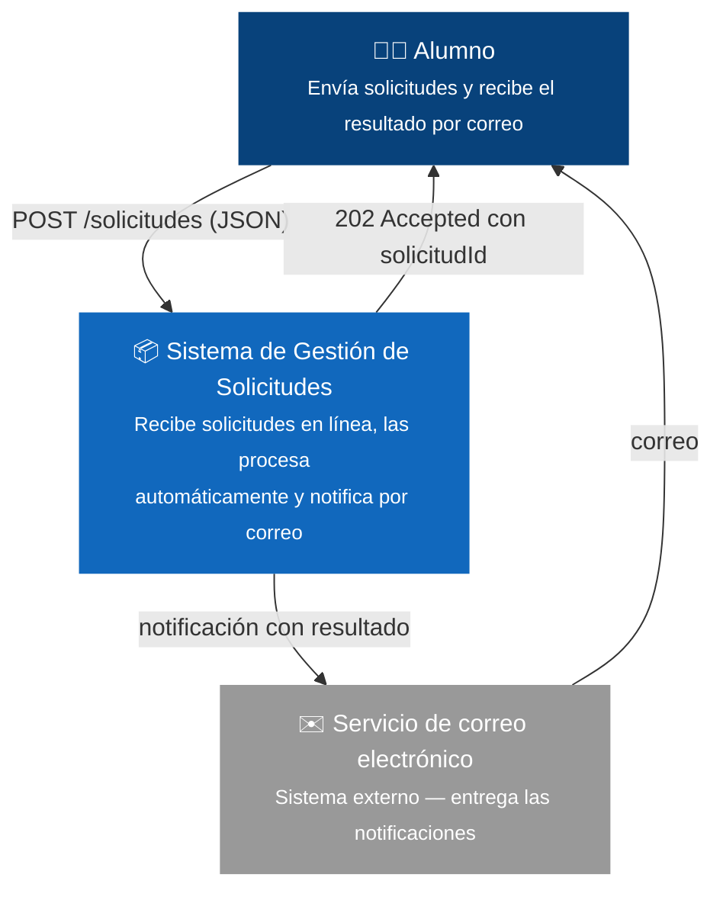
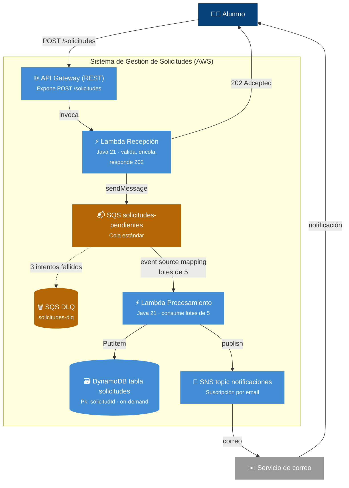
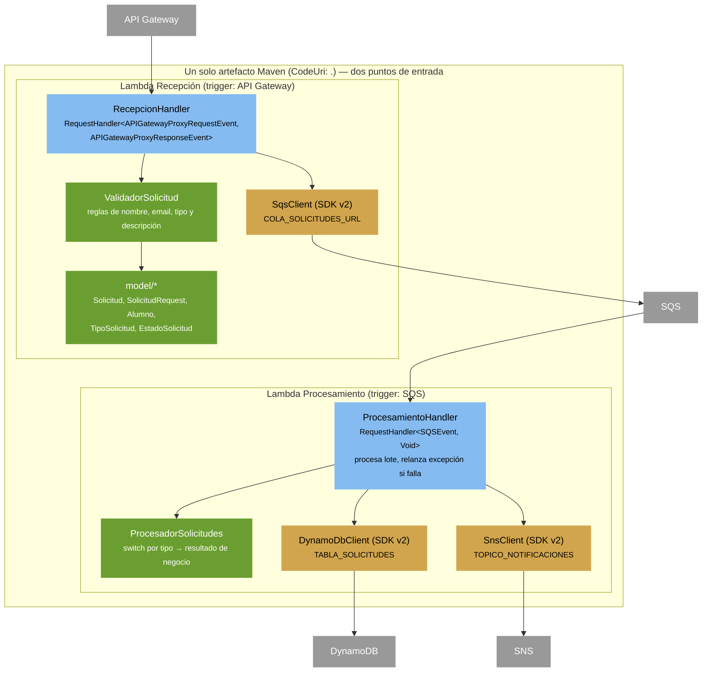
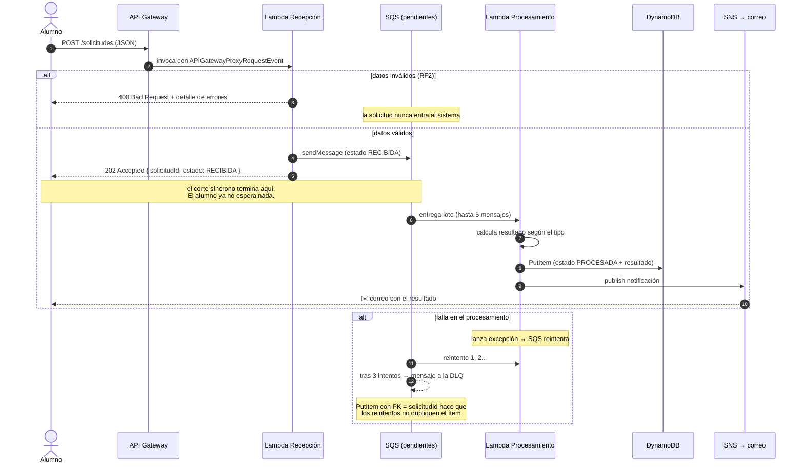

# README Paso a Paso — Sistema de Gestión de Solicitudes (Serverless en AWS)

Este documento narra el viaje completo del proyecto, en el orden en que se construyó:

| Paso | Fase | ¿Qué se hace? |
|---|---|---|
| 0 | Requerimiento | De dónde nace la necesidad y qué pide el negocio |
| 1 | BDD (Gherkin) | Declarar el comportamiento esperado a lo Cucumber, antes de escribir código |
| 2 | Diseño C4 | Diagramas C1 (contexto), C2 (contenedores) y C3 (componentes) en Mermaid |
| 3 | Transacciones | Diagrama de secuencia de la transacción de punta a punta (y su camino de falla) |
| 4 | Implementación | Las Lambdas en Java, en sus dos sabores: **trigger** (el sistema real) y **scheduler** (patrón complementario) |
| 5 | Paralelo | Cómo sería lo mismo con microservicios y otras tecnologías |
| 6 | Costos | Comparación serverless vs. alternativas |
| 7 | Implementación guiada | Cómo está armado el repo, cómo se despliega y cómo se demuestra |

> El detalle operativo (comandos, solución de problemas, costos del lab) vive en los README de
> cada proyecto: `paso01-local/README.md` (local con Docker) y `solicitudes-serverless/README.md`
> (nube real con AWS SAM). Las decisiones formales, en `documento-diseno.md`.

---

## Paso 0 — Punto de partida: el requerimiento

Una institución educativa recibe solicitudes de sus alumnos. Hoy ese flujo es **manual y lento**:
el alumno envía un correo o hace fila en oficina, alguien lo anota, lo deriva y después avisa.
Se quiere un sistema que reciba las solicitudes en línea y las procese **automáticamente**,
sin que el alumno espere en la llamada HTTP.

Tipos de solicitud soportados:

| Tipo | Descripción |
|---|---|
| `CERTIFICADO` | Solicitud de certificado (notas, alumno regular, etc.) |
| `REVISION_NOTAS` | Solicitud de revisión de notas de una asignatura |
| `SOPORTE_TECNICO` | Solicitud de soporte técnico |
| `INFO_ACADEMICA` | Solicitud de información académica |

### Requisitos funcionales

| # | Requisito |
|---|-----------|
| RF1 | El alumno registra una solicitud mediante `POST /solicitudes` con sus datos, tipo y descripción |
| RF2 | El sistema valida la solicitud en la recepción y rechaza con detalle los datos inválidos (HTTP 400) |
| RF3 | Las solicitudes válidas se procesan de forma **asíncrona** mediante una cola (el POST no espera el procesamiento) |
| RF4 | Cada solicitud procesada queda persistida con su estado y resultado |
| RF5 | Al finalizar el procesamiento, el alumno recibe una **notificación por correo** con el resultado |

### Requisitos no funcionales

| # | Requisito |
|---|-----------|
| RNF1 | Arquitectura **serverless**: sin servidores que administrar |
| RNF2 | **Desacoplamiento**: recepción y procesamiento comunican por cola (SQS) |
| RNF3 | **Resiliencia**: reintentos automáticos y cola de mensajes fallidos (DLQ) |
| RNF4 | **Infraestructura como código**: despliegue reproducible con AWS SAM |
| RNF5 | **Bajo costo**: servicios dentro del free tier de AWS para uso de laboratorio |

La palabra clave que da forma a todo lo que sigue es **asíncrono** (RF3): el alumno envía y se va;
el sistema procesa cuando puede; el correo (RF5) es la "llamada de vuelta".

---

## Paso 1 — Declarar el comportamiento: Gherkin a lo Cucumber

Antes de diseñar o programar, se **declara** qué debe pasar el sistema, en lenguaje Gherkin
(el formato de Cucumber: Given/When/Then → Dado/Cuando/Entonces). Estas especificaciones
ejecutables son el contrato de aceptación: si algún escenario deja de cumplirse, la
implementación rompió el requerimiento. Cada escenario se puede rastrear a un RF.

**`src/test/resources/features/recepcion.feature`**

```gherkin
Característica: Recepción de solicitudes de alumnos
  Como alumno quiero registrar una solicitud en línea
  para no tener que ir a la oficina o esperar un correo de respuesta manual.

  Antecedentes:
    Dado el servicio de solicitudes está disponible

  Escenario: Registrar una solicitud válida (RF1, RF3)
    Dado un alumno "María Pérez Soto" con correo "maria.perez@duocuc.cl"
    Cuando envía una solicitud de tipo "CERTIFICADO"
      Y la descripción "Necesito certificado de notas para postular a una beca"
    Entonces la respuesta es "202 Accepted"
      Y el cuerpo incluye un "solicitudId"
      Y el estado informado es "RECIBIDA"
      Y la solicitud quedó encolada para procesamiento asíncrono

  Escenario: Rechazar una solicitud inválida en la recepción (RF2)
    Dado un alumno "Ana" con correo "no-valido"
    Cuando envía una solicitud de tipo "PRESTAMO_LIBROS"
      Y la descripción "corta"
    Entonces la respuesta es "400 Bad Request"
      Y el cuerpo detalla cada error de validación
      Y la solicitud nunca entra al sistema (no se encola)

  Escenario: El nombre no cumple el largo mínimo (RF2)
    Cuando envía una solicitud con nombre de menos de 3 caracteres
    Entonces la respuesta es "400 Bad Request"
      Y el error menciona la regla del nombre (entre 3 y 100 caracteres)

  Escenario: La descripción no cumple el largo (RF2)
    Cuando envía una solicitud con descripción de menos de 10 caracteres
    Entonces la respuesta es "400 Bad Request"
      Y el error menciona la regla de la descripción (entre 10 y 500 caracteres)
```

**`src/test/resources/features/procesamiento.feature`**

```gherkin
Característica: Procesamiento asíncrono de solicitudes
  Las solicitudes válidas se procesan sin que el alumno espere,
  quedan registradas y el alumno es notificado por correo.

  Escenario: Procesar una solicitud y persistir el resultado (RF4)
    Dado una solicitud válida en la cola con tipo "CERTIFICADO"
    Cuando el procesador consume el mensaje
    Entonces la solicitud queda guardada con estado "PROCESADA"
      Y guarda un "resultado" acorde al tipo
      Y guarda "fechaProcesamiento"

  Escenario: Notificar al alumno por correo (RF5)
    Dado una solicitud recién procesada
    Entonces se publica una notificación con el resultado
      Y el alumno recibe un correo con asunto "Solicitud ... procesada"

  Escenario: Resultado según el tipo de solicitud (RF4)
    Cuando procesa una solicitud de tipo "REVISION_NOTAS"
    Entonces el resultado indica derivación al docente y plazo de 5 días hábiles
    Cuando procesa una solicitud de tipo "SOPORTE_TECNICO"
    Entonces el resultado indica ticket de soporte generado

  Escenario: Reintento ante falla y cola de mensajes fallidos (RNF3)
    Dado un mensaje que hace fallar el procesamiento
    Entonces el mensaje se reintenta hasta 3 veces
      Y tras el tercer intento queda en la cola "solicitudes-dlq" para auditoría
      Y no se duplica el ítem en la base de datos (idempotencia por "solicitudId")
```

> **Estado de estas declaraciones en el repo:** las reglas de validación ya están cubiertas por
> pruebas unitarias reales (`ValidadorSolicitudTest.java`, se ejecutan con `mvn test`). Los
> escenarios Gherkin quedan aquí como especificación de alto nivel; automatizarlos con el runner
> de Cucumber es la evolución natural del proyecto.

---

## Paso 2 — Diseño de la solución con C4 (C1, C2, C3)

El modelo C4 describe el sistema a tres alturas: contexto (quién lo usa), contenedores
(qué piezas lo forman) y componentes (qué hay dentro de cada pieza de código).

### C1 — Diagrama de contexto (el sistema como una caja negra)



**Lectura:** un solo actor, un solo sistema, un canal de vuelta. Nada más: esta es la promesa
completa del requerimiento y ya anticipa el desacoplamiento (la respuesta no contiene el resultado).

### C2 — Diagrama de contenedores (las piezas del sistema)



**Lectura:** el corte síncrono/asíncrono ocurre exactamente en la cola. Todo lo que está a la
izquierda de SQS debe responder rápido; todo lo que está a la derecha puede tardar, reintentar
y fallar sin que el alumno se entere en la llamada HTTP.

### C3 — Diagrama de componentes (dentro del código Java)



**Lecturas clave del diseño:**

- **Un JAR, dos funciones.** Ambas Lambdas comparten `model/`, la lógica y el `pom.xml`; lo único
  que las distingue es el *handler* declarado en `template.yaml` y el evento que las dispara.
- **Sin framework** (decisión D7): Java 21 + AWS SDK v2 + Jackson puros. El estudiante ve el
  evento real de Lambda tal cual llega.
- **La validación es un componente propio** (`ValidadorSolicitud`): es lo único con prueba
  unitaria, porque es la única lógica con ramas que puede fallar en la recepción.

---

## Paso 3 — Diagrama de transacciones

La transacción de punta a punta, con su camino feliz y sus dos caminos de falla:



**Tres propiedades de esta transacción:**

| Propiedad | Cómo se logra |
|---|---|
| **Es eventualmente consistente** | La respuesta 202 promete "recibida", no "procesada". La verdad final vive en DynamoDB y en el correo. |
| **Es exactamente-una-vez a efectos prácticos** | `PutItem` con PK = `solicitudId`: un reintento del mismo mensaje sobrescribe el ítem en vez de duplicarlo (idempotencia natural, decisión D6). |
| **Aísla los fallos** | Datos inválidos → 400 y fuera (no consume cola). Fallo de infraestructura → reintento y DLQ, sin bloquear a los demás mensajes (visibility timeout 60 s > timeout de la Lambda de 25 s). |

---

## Paso 4 — Implementación: las Lambdas en Java, dos sabores

Toda Lambda es una función Java con un método `handleRequest(evento, contexto)`. Lo que cambia
entre "sabores" es **quién la despierta y con qué evento**. Ambos sabores se implementan en Java
con la interfaz `RequestHandler<I, O>` del SDK de Lambda.

### Sabor 1 — Trigger: la Lambda que responde a eventos (el sistema real)

Las dos funciones del proyecto son de este sabor. Cada una implementa
`RequestHandler<TipoDeEvento, TipoDeSalida>`, y el tipo del evento lo define el disparador.

**1a. Trigger síncrono: API Gateway** — `solicitudes-serverless/src/main/java/duoc/cloud/solicitudes/RecepcionHandler.java`

```java
public class RecepcionHandler
        implements RequestHandler<APIGatewayProxyRequestEvent, APIGatewayProxyResponseEvent> {

    @Override
    public APIGatewayProxyResponseEvent handleRequest(
            APIGatewayProxyRequestEvent event, Context context) {

        // 1. Parsear el cuerpo JSON (Jackson)
        SolicitudRequest request = MAPPER.readValue(event.getBody(), SolicitudRequest.class);

        // 2. Validar: si hay errores, 400 y NO se encola
        List<String> errores = ValidadorSolicitud.validar(request);
        if (!errores.isEmpty()) {
            return respuesta(400, MAPPER.writeValueAsString(Map.of("errores", errores)));
        }

        // 3. Armar la Solicitud completa con id único y estado RECIBIDA
        Solicitud solicitud = nuevaSolicitud(request);   // UUID + Instant.now()

        // 4. Encolar para el procesamiento asíncrono
        sqs.sendMessage(SendMessageRequest.builder()
                .queueUrl(colaUrl)                        // viene de COLA_SOLICITUDES_URL
                .messageBody(MAPPER.writeValueAsString(solicitud))
                .build());

        // 5. Responder 202: aceptada, todavía no procesada
        return respuesta(202, MAPPER.writeValueAsString(Map.of(
                "solicitudId", solicitud.getSolicitudId(),
                "estado", solicitud.getEstado(),
                "mensaje", "Su solicitud fue recibida y será procesada en breve. "
                        + "Recibirá un correo cuando esté lista.")));
    }
}
```

**1b. Trigger asíncrono: SQS** — `ProcesamientoHandler.java`

```java
public class ProcesamientoHandler implements RequestHandler<SQSEvent, Void> {

    @Override
    public Void handleRequest(SQSEvent event, Context context) {
        for (SQSEvent.SQSMessage mensaje : event.getRecords()) {   // lote de hasta 5
            try {
                Solicitud solicitud = MAPPER.readValue(mensaje.getBody(), Solicitud.class);

                // 1. Resultado de negocio según el tipo
                String resultado = ProcesadorSolicitudes.procesar(
                        TipoSolicitud.desde(solicitud.getTipo()));

                // 2. Persistir el estado final
                solicitud.setEstado(EstadoSolicitud.PROCESADA.name());
                solicitud.setResultado(resultado);
                guardar(solicitud);   // PutItem en DynamoDB

                // 3. Notificar al alumno
                notificar(solicitud, log);   // publish en SNS

            } catch (Exception e) {
                // Relanzar = decirle a SQS "este mensaje falló":
                // reintenta, y al 3er intento va a la DLQ.
                throw new RuntimeException("Fallo el procesamiento de la solicitud", e);
            }
        }
        return null;   // Void: una Lambda por cola no devuelve nada
    }
}
```

Lo que conecta cada trigger con su función es solo el `template.yaml`:

```yaml
FuncionRecepcion:
  Type: AWS::Serverless::Function
  Properties:
    Handler: duoc.cloud.solicitudes.RecepcionHandler::handleRequest
    Events:
      PostSolicitudes:
        Type: Api                    # ← trigger: API Gateway
        Properties: { Path: /solicitudes, Method: post }

FuncionProcesamiento:
  Type: AWS::Serverless::Function
  Properties:
    Handler: duoc.cloud.solicitudes.ProcesamientoHandler::handleRequest
    Events:
      ConsumirCola:
        Type: Sqs                    # ← trigger: event source mapping
        Properties: { Queue: !GetAtt ColaSolicitudes.Arn, BatchSize: 5 }
```

### Sabor 2 — Scheduler: la Lambda que se ejecuta por reloj

El segundo sabor no espera ningún evento: **se despierta sola según una agenda** de EventBridge
(cron o `rate`). El sistema actual no la necesita —procesa según llega trabajo—, pero es el patrón
natural para tareas periódicas. Un ejemplo que encaja con este dominio: un **resumen diario** de
la operación, que cuenta las solicitudes procesadas y avisa por el mismo tópico SNS.

```java
public class ReporteDiarioHandler implements RequestHandler<ScheduledEvent, Void> {

    private final DynamoDbClient dynamo = DynamoDbClient.create();
    private final SnsClient sns = SnsClient.create();
    private final String tabla = System.getenv("TABLA_SOLICITUDES");
    private final String topico = System.getenv("TOPICO_NOTIFICACIONES");

    @Override
    public Void handleRequest(ScheduledEvent event, Context context) {
        long procesadas = dynamo.scan(ScanRequest.builder()
                .tableName(tabla)
                .filterExpression("#e = :estado",
                        Map.of("#e", AttributeValue.builder().s("estado").build()))
                .expressionAttributeValues(Map.of(
                        ":estado", AttributeValue.builder().s("PROCESADA").build()))
                .build())
            .count();

        sns.publish(PublishRequest.builder()
                .topicArn(topico)
                .subject("Resumen diario de solicitudes")
                .message("Solicitudes procesadas hasta ahora: " + procesadas)
                .build());
        return null;
    }
}
```

Su registro en SAM: la única diferencia con un trigger es el tipo de evento:

```yaml
FuncionReporteDiario:
  Type: AWS::Serverless::Function
  Properties:
    Handler: duoc.cloud.solicitudes.ReporteDiarioHandler::handleRequest
    Runtime: java21
    Events:
      AgendaDiaria:
        Type: Schedule                       # ← trigger: reloj (EventBridge)
        Properties:
          Schedule: rate(1 day)              # o cron(0 13 * * ? *) = 13:00 UTC
```

### Comparación de los dos sabores

| Aspecto | Trigger (lo que usa el sistema) | Scheduler |
|---|---|---|
| ¿Quién la invoca? | Un evento: llamada HTTP, mensaje en cola | El reloj de EventBridge (`rate`/`cron`) |
| Frecuencia | La que pida el tráfico (escala a cero) | Fija, aunque no haya trabajo |
| Tipo de evento Java | `APIGatewayProxyRequestEvent`, `SQSEvent`, ... | `ScheduledEvent` |
| Cuesta cuando no hay trabajo | $0 (no se invoca, no se paga) | Se paga cada ejecución agendada |
| ¿Debe ser idempotente? | Sí (SQS puede reentregar) | Normalmente sí (se superpone si tarda más que su período) |
| En este proyecto | `RecepcionHandler` y `ProcesamientoHandler` | Extensión didáctica (`ReporteDiarioHandler`), no desplegada |

---

## Paso 5 — Paralelo: lo mismo con microservicios y otras tecnologías

La arquitectura serverless de este proyecto tiene un espejo directo en el mundo de
microservicios. Misma lógica de negocio, distinta responsabilidad operativa:

| Rol en la solución | Serverless (este proyecto) | Microservicios clásicos (Spring) |
|---|---|---|
| Punto de entrada | API Gateway + Lambda Recepción | Spring Boot con `@RestController` (`POST /solicitudes`) |
| Cola de desacople | SQS (+ DLQ administrada) | RabbitMQ o Apache Kafka (+ política de reintentos propia) |
| Procesador | Lambda Procesamiento (consume lotes de 5) | Consumidor `@RabbitListener` / `@KafkaListener` en otro servicio |
| Persistencia | DynamoDB (PutItem, clave simple) | PostgreSQL + Spring Data JPA (`SolicitudRepository`) |
| Notificación | SNS (publish y listo) | `JavaMailSender` (SMTP) o servicio de correo |
| Empaquetado | Un JAR, dos handlers, ~50 MB | Dos JARs Spring Boot (o imágenes Docker de ~200-500 MB c/u) |
| Despliegue | `sam deploy` (template IaC) | Docker/Kubernetes: manifiestos, charts, ingress, HPA |
| Configuración | Variables de entorno inyectadas por SAM | `application.yml`, ConfigMap/Secret, Spring Cloud Config |
| Observabilidad | CloudWatch (logs y métricas incluidas) | Micrometer + Prometheus + Grafana (hay que montarlo) |
| Escalado | Automático por invocación | Auto-scaling de pods/instancias que hay que configurar |

**En código**, el equivalente Spring de `ProcesamientoHandler` sería un listener:

```java
// Microservicio clásico: el "event source mapping" lo escribes tú
@RabbitListener(queues = "solicitudes-pendientes")
public void procesar(Solicitud solicitud) {
    String resultado = ProcesadorSolicitudes.procesar(solicitud.getTipo());
    repository.save(solicitud.conEstado(PROCESADA, resultado));  // JPA
    emailSender.enviar(solicitud.getAlumno().getEmail(), resultado);
}
```

La lógica de negocio (`ProcesadorSolicitudes`, `ValidadorSolicitud`, el `model/`) es **idéntica**:
al no usar framework, es Java plano portable. Lo que cambia no es el negocio, sino quién opera
la infraestructura alrededor.

**Otras tecnologías para el mismo problema:**

| Alternativa | Cuándo tendría sentido |
|---|---|
| Step Functions | Si el procesamiento fuera un flujo con pasos o aprobaciones (ej.: revisión de notas la decide un docente) — está en las mejoras futuras |
| Spring Cloud Function / Quarkus Funqy | Si el equipo quisiera el mismo código portable entre Lambda y microservicio (a costa de una capa de abstracción) |
| Python / Node en Lambda | Menos cold-start que Java para cargas ligeras; aquí se usa Java 21 porque es el curso |
| ECS/Fargate con contenedores | Si las funciones fueran de larga duración o necesitaran librerías no compatibles con el runtime de Lambda |

---

## Paso 6 — Comparación de costos

### A escala de laboratorio (este proyecto: ~10 solicitudes/día)

| Servicio | Free tier | Costo real con este uso |
|---|---|---|
| Lambda | 1M solicitudes + 400.000 GB-s/mes | $0 |
| DynamoDB | 25 GB + 25 WCU/RCU (on-demand) | $0 |
| SQS | Primer millón de solicitudes/mes | $0 |
| SNS | Primeros 1.000 correos/mes | $0 |
| API Gateway REST | Sin free tier permanente | ≈ $0 ( centavos a este volumen) |
| **Total mensual** | | **≈ $0** |

### A escala producción moderada (~100.000 solicitudes/mes)

| Componente | Serverless (este diseño) | Microservicios clásicos |
|---|---|---|
| Cómputo | Lambda: ~$0–2 (dentro o cerca del free tier) | Fargate 0.25 vCPU/0.5 GB 24/7: ~$9/mes **aunque no llegue ninguna solicitud** |
| API | API Gateway: ~$0.35 | ALB: ~$16/mes fijo |
| Base de datos | DynamoDB on-demand: ~$0.15 | RDS t4g.micro: ~$12/mes fijo |
| Mensajería | SQS: ~$0.40 | RabbitMQ administrado (Amazon MQ): ~$25/mes fijo |
| **Total aprox.** | **~$3–5/mes, escala a $0 si nadie usa el sistema** | **~$60/mes, de nada sirve dormir** |

### El punto pedagógico

- El modelo serverless cobra **por trabajo hecho**; el de contenedores/servidores cobra **por
  tiempo aprovisionado**. Con tráfico intermitente (típico de una institución: picos de
  inscripción, valles en vacaciones), serverless gana por goleada.
- Con **carga constante y muy alta** (millones de invocaciones/hora, siempre encendidas) el
  cálculo se puede dar vuelta: capacidad reservada de contenedores puede salir más barata que
  millones de invocaciones. Es el clásico trade-off *elasticidad* vs. *economía de escala*.
- En el laboratorio esto se traduce en una regla práctica: `sam delete` al terminar cada sesión
  (el Learner Lab tiene presupuesto limitado) y un solo `sam deploy` para reconstruir todo.

---

## Paso 7 — Explicación de la implementación

### Cómo está organizado el repositorio

```
salida/
├── documento-diseno.md        Diseño formal: decisiones D1–D9, contrato API, modelo de datos
├── README-paso-paso.md        Este documento
├── paso01-local/              PASO A: el sistema completo en tu computador (Docker)
│   ├── docker-compose.yml     LocalStack emula API GW, Lambda, SQS, DynamoDB, SNS, CloudWatch
│   ├── Makefile               make up · make demo · make avisos · make estado
│   └── java/                  El mismo código Java del paso B (detecta el ambiente con AWS_ENDPOINT_URL)
└── solicitudes-serverless/    PASO B: el sistema real en AWS
    ├── template.yaml          TODA la infraestructura en un archivo (SAM)
    ├── pom.xml                Java 21 + AWS SDK v2 + Jackson (sin framework)
    └── src/main/java/duoc/cloud/solicitudes/
        ├── RecepcionHandler.java     Lambda 1 (trigger API Gateway): valida → encola → 202
        ├── ProcesamientoHandler.java Lambda 2 (trigger SQS): procesa → guarda → notifica
        ├── ProcesadorSolicitudes.java Lógica pura: resultado según tipo (switch de Java 21)
        ├── model/                     Solicitud, SolicitudRequest, Alumno, tipos y estados
        └── validacion/ValidadorSolicitud.java  Reglas RF2 (con su test unitario)
```

**La estrategia didáctica:** primero local (paso01-local), después nube (solicitudes-serverless).
El código es el mismo; en local, la variable `AWS_ENDPOINT_URL` redirige el SDK a LocalStack y no
hay que tocar nada más.

### Recorrido de una solicitud por el código

1. **Entra por `RecepcionHandler.handleRequest`.** El evento es un
   `APIGatewayProxyRequestEvent` (cuerpo JSON, headers, método). Se parsea con Jackson a
   `SolicitudRequest`.
2. **`ValidadorSolicitud.validar`** devuelve la lista de errores (nombre 3–100, email con
   formato, tipo de los 4 válidos, descripción 10–500). Con errores → `400` con el detalle
   y terminamos; nada más pasa.
3. Se arma la `Solicitud` completa: `UUID` como `solicitudId`, estado `RECIBIDA`,
   `fechaCreacion` ISO-8601. Se envía como mensaje JSON a SQS y se responde **202**.
4. SQS entrega un **lote de hasta 5 mensajes** a `ProcesamientoHandler.handleRequest`
   (`SQSEvent`). Por cada mensaje: `ProcesadorSolicitudes.procesar(tipo)` calcula el
   resultado con un `switch` de Java 21.
5. **`guardar`** hace `PutItem` en DynamoDB con estado `PROCESADA`, `fechaProcesamiento` y
   `resultado`. La PK es el `solicitudId`: los reintentos sobrescriben en vez de duplicar.
6. **`notificar`** publica en SNS; la suscripción por correo entrega el mensaje al alumno.
7. Si algo falla en 4–6, se **relanza la excepción**: SQS reintenta y, al tercer intento,
   el mensaje va a la DLQ (`maxReceiveCount: 3`).

### Despliegue en tres comandos

```bash
sam build              # compila el JAR (y corre las pruebas unitarias)
sam deploy --guided    # despliega TODO: API, Lambdas, colas, tabla, tópico (~3 min)
sam delete             # borra todo al terminar la sesión (presupuesto del lab)
```

Detalles del entorno que importan:

- **Región**: `us-east-1` o `us-west-2`, las únicas que permite el Learner Lab.
- **Rol `LabRole`**: el lab no permite crear IAM, así que ambas funciones usan el rol
  pre-existente del lab (decisión D9). En producción sería mínimo privilegio por función.
- **Confirmar el correo** de suscripción SNS después del primer deploy, o las notificaciones
  no llegan.

### Demo de punta a punta (checklist)

| # | Acción | Resultado esperado |
|---|---|---|
| 1 | `POST /solicitudes` válido (curl o Postman) | `202` con `solicitudId` y `estado: RECIBIDA` |
| 2 | Esperar ~10 segundos | Correo con asunto "Solicitud … procesada" y el resultado según el tipo |
| 3 | Consola DynamoDB | Ítem con `estado: PROCESADA`, `resultado` y ambas fechas |
| 4 | Consola SQS | `pendientes` vuelve a 0 mensajes; la DLQ sigue vacía |
| 5 | `POST` inválido (tipo desconocido, email malo) | `400` con el detalle; nada más pasa (no hay correo ni ítem) |
| 6 | CloudWatch | Logs de ambas funciones, uno por invocación |

### Cierre: qué se aprendió en el camino

1. **El requerimiento manda**: "asíncrono" (RF3) es la única decisión que condiciona todo —
   cola, 202, notificación por correo.
2. **Declarar antes de construir**: los escenarios Gherkin del Paso 1 son la lista de verificación
   contra la que se valida la implementación.
3. **Diseñar a tres alturas (C4)**: contexto para acordar con el negocio, contenedores para
   acordar la arquitectura, componentes para sentarse a programar.
4. **Una Lambda es solo una función Java**: el "sabor" (trigger o scheduler) lo define el
   evento declarado en el template, no el código.
5. **Serverless ≠ magia**: es repartir responsabilidad — menos operación, pero mayor dependencia
   de las buenas prácticas de idempotencia, DLQ e IaC que este proyecto implementa.
