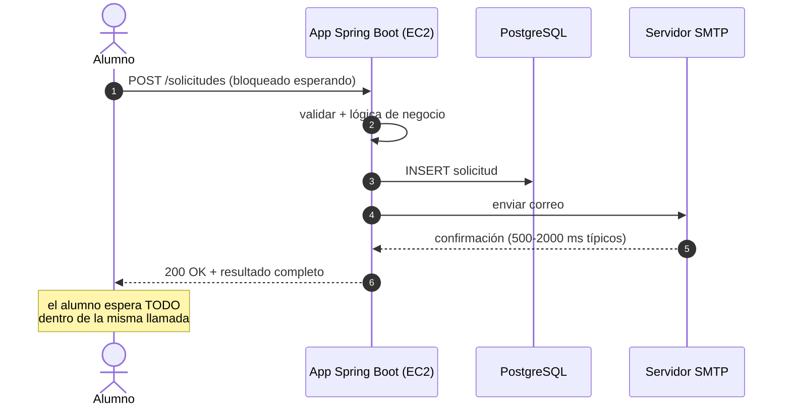
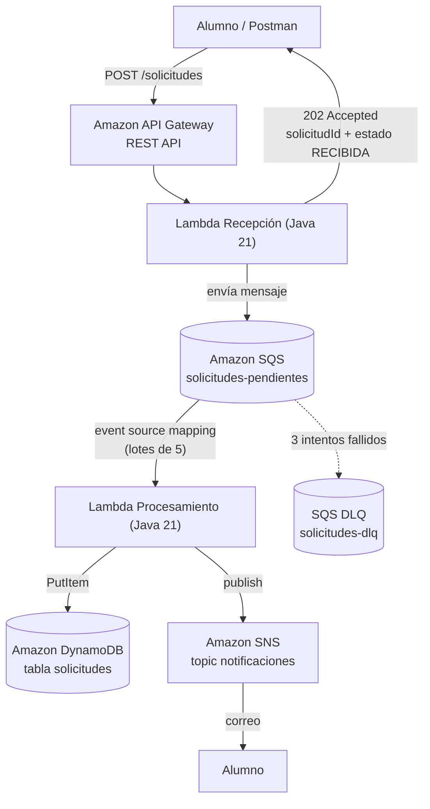
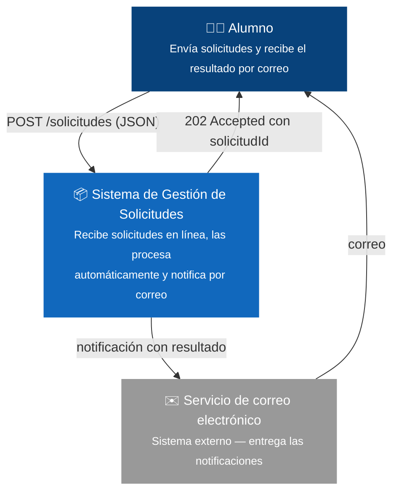
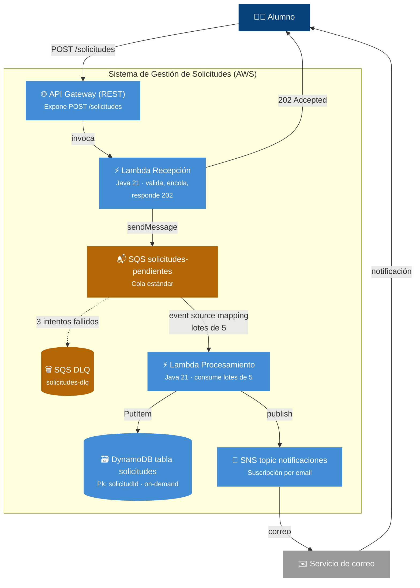
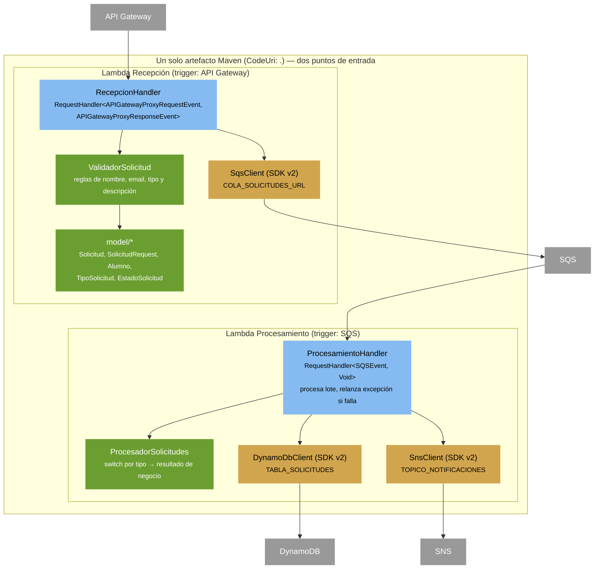
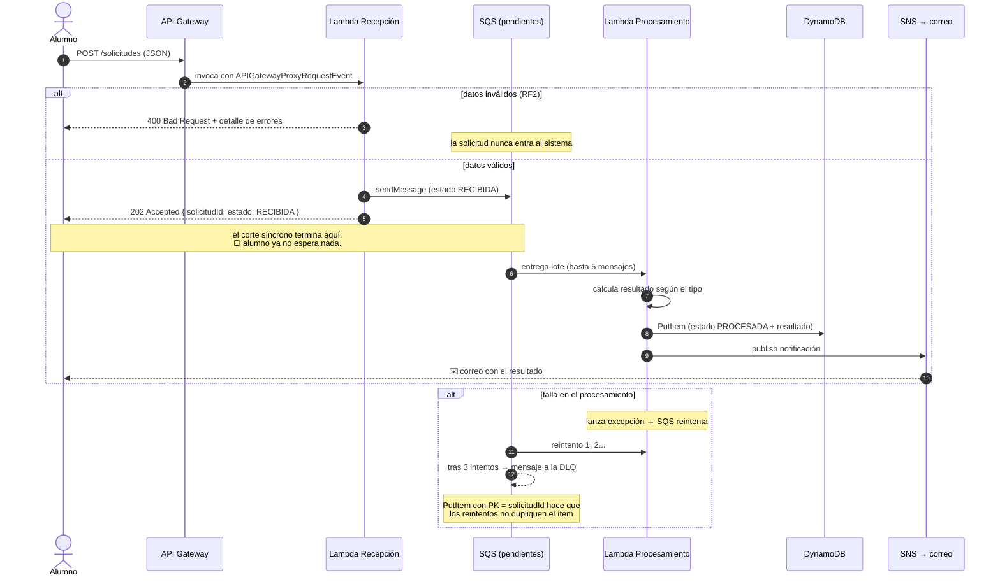

# Sistema de Gestión de Solicitudes Estudiantiles — del enfoque tradicional a la arquitectura asíncrona serverless

**Curso:** JAVA — Diseño y Construcción de Soluciones Nativas en Nube
**Fecha:** Noviembre 2026 · **Versión:** 2.0

Este documento cuenta la historia completa del proyecto como la contaríamos en una clase:
no parte del código final, sino de **cómo lo habríamos resuelto con el enfoque tradicional**,
**qué problema aparece** cuando el sistema se enfrenta a usuarios reales, y **cómo la
arquitectura asíncrona serverless lo resuelve**. A partir de ahí recorre el viaje completo:
declaración del comportamiento (BDD/Gherkin), diseño con el modelo C4, transacciones,
implementación de las Lambdas en Java, el paralelo con microservicios y la comparación de costos.

| Parte | Contenido |
|---|---|
| 1 | El requerimiento: de dónde nace todo |
| 2 | La primera aproximación: la solución tradicional (síncrona) |
| 3 | El problema detectado: velocidad, carga y costo |
| 4 | La solución alternativa: arquitectura asíncrona serverless |
| 5 | Declarar el comportamiento: Gherkin a lo Cucumber |
| 6 | Diseño de la solución con C4 (C1, C2, C3) |
| 7 | Diagrama de transacciones |
| 8 | Las Lambdas en Java: dos sabores (trigger y scheduler) |
| 9 | El paralelo: microservicios y otras tecnologías |
| 10 | Comparación de costos |
| 11 | La implementación: repositorio, despliegue y demo |
| 12 | Aprendizajes y mejoras futuras |

---

# Parte 1 — El requerimiento

Una institución educativa recibe solicitudes de sus alumnos. Hoy ese flujo es **manual y lento**:
el alumno envía un correo o hace fila en oficina, alguien lo anota, lo deriva a otra área y,
días después, alguien avisa al alumno. El proceso no deja rastro verificable y el alumno no
sabe en qué va su trámite.

Se quiere un sistema que reciba las solicitudes **en línea** y las procese **automáticamente**,
sin que el alumno espere en la llamada HTTP mientras el trámite avanza.

Tipos de solicitud soportados:

| Tipo | Descripción |
|---|---|
| `CERTIFICADO` | Solicitud de certificado (notas, alumno regular, etc.) |
| `REVISION_NOTAS` | Solicitud de revisión de notas de una asignatura |
| `SOPORTE_TECNICO` | Solicitud de soporte técnico |
| `INFO_ACADEMICA` | Solicitud de información académica |

## Requisitos funcionales

| # | Requisito |
|---|-----------|
| RF1 | El alumno registra una solicitud mediante `POST /solicitudes` con sus datos, tipo y descripción |
| RF2 | El sistema valida la solicitud en la recepción y rechaza con detalle los datos inválidos (HTTP 400) |
| RF3 | Las solicitudes válidas se procesan de forma **asíncrona** mediante una cola (el POST no espera el procesamiento) |
| RF4 | Cada solicitud procesada queda persistida con su estado y resultado |
| RF5 | Al finalizar el procesamiento, el alumno recibe una **notificación por correo** con el resultado |

## Requisitos no funcionales

| # | Requisito |
|---|-----------|
| RNF1 | Arquitectura **serverless**: sin servidores que administrar |
| RNF2 | **Desacoplamiento**: recepción y procesamiento comunican por cola (SQS) |
| RNF3 | **Resiliencia**: reintentos automáticos y cola de mensajes fallidos (DLQ) |
| RNF4 | **Infraestructura como código**: despliegue reproducible con AWS SAM |
| RNF5 | **Bajo costo**: servicios dentro del free tier de AWS para uso de laboratorio |

La palabra clave que condiciona todo el diseño es **asíncrono** (RF3): el alumno envía y se va;
el sistema procesa cuando puede; el correo (RF5) es la "llamada de vuelta". El resto del
documento explica por qué llegamos a esa palabra: primero sufriéndola en carne propia
con la solución tradicional y después resolviéndola con la arquitectura asíncrona.

---

# Parte 2 — La primera aproximación: la solución tradicional (síncrona)

## 2.1 Cómo se vería

Un equipo con formación clásica en Java resolvería esto con una aplicación web monolítica:
un servidor que expone un endpoint REST y que, **dentro de la misma llamada HTTP**, hace todo:

1. Recibe el JSON con la solicitud.
2. Valida los campos.
3. Ejecuta la lógica de negocio (emitir certificado, derivar revisión, generar ticket...).
4. Guarda la solicitud en una base de datos relacional.
5. Envía el correo de confirmación vía SMTP.
6. Recién ahí responde `200 OK` con el resultado completo.



El código típico del controlador (ilustrativo, en el stack clásico) se vería así:

```java
@RestController
public class SolicitudController {

    @PostMapping("/solicitudes")
    public ResponseEntity<?> registrar(@RequestBody SolicitudRequest request) {
        List<String> errores = validador.validar(request);
        if (!errores.isEmpty()) {
            return ResponseEntity.badRequest().body(Map.of("errores", errores));
        }
        String resultado = procesador.procesar(request.getTipo()); // lógica de negocio
        Solicitud s = repositorio.save(mapear(request, resultado)); // JPA/PostgreSQL
        emailSender.enviar(request.getEmail(), resultado);          // SMTP dentro del request
        return ResponseEntity.ok(mapear(s));
    }
}
```

## 2.2 Tecnologías aplicadas (solución tradicional)

| # | Tecnología | Rol en la solución | Propósito |
|---|---|---|---|
| T1 | Java 21 (JDK) | Lenguaje de la aplicación | Lógica de negocio orientada a objetos, tipado fuerte |
| T2 | Spring Boot 3 | Framework de aplicación | Autoconfiguración, servidor embebido, inyección de dependencias |
| T3 | Spring Web MVC | Capa web | Exponer el endpoint `POST /solicitudes` como REST |
| T4 | Spring Data JPA + Hibernate | Capa de datos | Mapear entidades Java a tablas relacionales |
| T5 | PostgreSQL 16 | Base de datos | Persistir solicitudes, integridad transaccional (ACID) |
| T6 | Tomcat embebido | Servidor de aplicaciones | Atender HTTP con un pool de hilos de trabajo |
| T7 | Spring Mail (SMTP) | Notificaciones | Enviar el correo con el resultado al alumno |
| T8 | Maven | Construcción | Compilar, probar y empaquetar el JAR |
| T9 | JUnit + Mockito | Pruebas | Pruebas unitarias de la validación y el negocio |
| T10 | EC2 / servidor VPS | Infraestructura | Una o más máquinas virtuales corriendo el JAR 24/7 |
| T11 | Docker (opcional) | Empaquetado de despliegue | Empaquetar la app + runtime en una imagen portable |

**Lectura de la tabla:** son tecnologías maduras y bien conocidas. Nada de esto está mal en
sí mismo: es exactamente el stack que la mayoría de los sistemas corporativos tiene en
producción. El problema no es *qué* usamos, sino *cómo* se organiza el flujo.

## 2.3 Por qué esta solución es razonable (al principio)

- **Simplicidad conceptual:** todo ocurre en un solo proceso, en un solo hilo de ejecución
  por request. Es fácil de entender, depurar y probar.
- **Transaccionalidad local:** el `INSERT` y la lógica comparten una transacción de base de
  datos; si algo falla, todo se revierte junto (ACID).
- **Respuesta inmediata y completa:** el alumno envía y recibe el resultado en la misma
  llamada; no hace falta notificación posterior.
- **El equipo ya sabe operarla:** JVM, Spring y PostgreSQL son el pan de cada día.

Con diez alumnos por día, esta solución funciona perfectamente. El problema aparece cuando
el sistema se encuentra con la realidad de una institución completa.

---

# Parte 3 — El problema detectado: velocidad, carga y costo

## 3.1 Velocidad: el alumno paga el costo de todo el flujo

En el diseño síncrono, el tiempo de respuesta del `POST` es la **suma** de todas las etapas.
Con valores típicos de cada etapa:

| Etapa | Tiempo típico | ¿El alumno necesita esperarla? |
|---|---|---|
| Validación de campos | ~5 ms | Sí (necesita saber si hubo errores) |
| Lógica de negocio (definir resultado) | ~10-50 ms | No (el resultado puede llegar después) |
| INSERT en la base de datos | ~10-30 ms | No (es un detalle interno) |
| Envío de correo SMTP | ~500-2000 ms | No (el correo ES la respuesta) |
| **Total del POST** | **~0,6-2,1 s** | Debería ser **< 100 ms** |

El correo es la etapa lenta dominante: puede representar más del **90% del tiempo de
respuesta**, y es precisamente la etapa que el alumno **no** necesita esperar. Peor aún: si el
servidor SMTP está lento o caído, la llamada falla **completa** — el alumno reintenta y genera
una solicitud duplicada.

> **Regla que aprendemos aquí:** el tiempo de respuesta de una operación debería ser el tiempo
> de lo esencial, no la suma de todas las consecuencias de esa operación.

## 3.2 Carga: los picos no se absorben, se sufren

La matrícula y el cierre de semestre concentran miles de solicitudes en minutos. En el
modelo síncrono cada request **ocupa un hilo bloqueado** durante todo el flujo:

- Tomcat atiende ~200 hilos por instancia: 200 solicitudes "en vuelo" y las demás esperan
  cola en el socket.
- La base de datos se convierte en cuello de botella: cada request sostiene una conexión
  del pool mientras *envía un correo*.
- Si el alumno ve timeout, reintenta: la carga se **multiplica** justo cuando el sistema
  está más débil.
- La única palanca de escala es **agregar instancias completas**: escalar todo (web, lógica,
  correo) cuando solo una parte está congestionada.

## 3.3 Costo: se paga por tiempo aprovisionado, no por trabajo hecho

El servidor debe estar encendido las 730 horas del mes para atender picos que duran pocas
horas a la semana:

| Recurso de la solución tradicional | Costo mensual aproximado | ¿Trabaja las 730 horas? |
|---|---|---|
| EC2 t3.small (app Spring Boot) | ~USD 15 | No: picos de pocas horas |
| RDS t4g.micro (PostgreSQL) + backups | ~USD 13-18 | No: uso intermitente |
| IP elástica, almacenamiento, transferencia | ~USD 3-5 | — |
| **Total** | **~USD 30-40/mes** | Capacidad ociosa la mayoría del tiempo |

Y ese es el costo de un sistema **pequeño**. Si el volumen crece, la escalabilidad vertical
(o agregar instancias) escala el costo de forma lineal con la capacidad, no con el uso real.

## 3.4 Resumen del diagnóstico

| Síntoma | Causa raíz | Consecuencia |
|---|---|---|
| El POST demora segundos | El flujo completo viaja dentro de una llamada HTTP | Mala experiencia; timeouts del cliente |
| Solicitudes duplicadas | El cliente reintenta cuando expira | Doble procesamiento, correos repetidos |
| Degradación en picos de matrícula | Hilos bloqueados + pool de conexiones al límite | El sistema entero se cae por un solo eslabón |
| Un SMTP lento tira abajo el registro | Acoplamiento fuerte entre etapas | El fallo de lo "no esencial" bloquea lo esencial |
| Costo fijo mes a mes | Se paga por capacidad aprovisionada | Se factura tiempo ocioso |

**Conclusión del diagnóstico:** el problema no es el framework ni la base de datos; es el
**acoplamiento temporal** de las etapas. La cura no es "más máquina": es **desacoplar el
recibir del procesar**.

---

# Parte 4 — La solución alternativa: arquitectura asíncrona serverless

## 4.1 La idea clave en una frase

> **Separar "recibir" de "procesar" con una cola**: la recepción solo valida y encola, responde
> `202 Accepted` en milisegundos con un identificador de solicitud, y un procesador desacoplado
> hace el trabajo pesado, guarda el resultado y **notifica por correo**, que pasa a ser la
> "llamada de vuelta" al alumno.



## 4.2 Tecnologías a aplicar (solución asíncrona)

| # | Tecnología | Rol en la solución | Reemplaza a (en la tradicional) |
|---|---|---|---|
| S1 | Amazon API Gateway (REST) | Punto de entrada HTTP | Tomcat + Spring MVC |
| S2 | AWS Lambda (Java 21) | Recepción y procesamiento sin servidores | EC2 + aplicación Spring Boot |
| S3 | Amazon SQS (cola estándar) | Cola de solicitudes pendientes | — (no existía: era una llamada interna) |
| S4 | Amazon SQS DLQ | Auditoría de mensajes que fallan 3 veces | Logs y "rezos" |
| S5 | Amazon DynamoDB | Persistencia de solicitudes procesadas | PostgreSQL + JPA |
| S6 | Amazon SNS (email) | Notificación del resultado | Spring Mail + servidor SMTP |
| S7 | AWS SAM (template.yaml) | Infraestructura como código | Provisionamiento manual / scripts |
| S8 | Amazon CloudWatch | Logs y monitoreo de cada ejecución | Logs de archivos en la instancia |
| S9 | LocalStack (Docker) | Emulación local de AWS para desarrollo | Un entorno de pruebas dedicado |
| S10 | Java 21 + AWS SDK v2 + Jackson | Código de las funciones | Spring Boot + JPA + Hibernate |
| S11 | Maven | Construcción y pruebas | Igual |

## 4.3 Explicación de cada tecnología y su propósito

### Amazon API Gateway — la puerta de entrada administrada

Expone `POST /solicitudes` como una API REST con URL propia, TLS y throttling, sin que
configuremos un solo servidor ni certificado. **Propósito en el proyecto:** recibir las
llamadas HTTP de los alumnos e invocar la Lambda de recepción; ante picos, amortigua y
protege el backend.

### AWS Lambda — cómputo por invocación

Ejecuta una función Java (método `handleRequest`) por cada evento, escala automáticamente
de 0 a miles de ejecuciones concurrentes y **solo se paga mientras el código corre**.
**Propósito:** acá corre la recepción (validar + encolar + responder 202) y el procesamiento
(consumir lote + persistir + notificar). Es el reemplazo del servidor entero.

### Amazon SQS — la cola que desacopla el sistema

Cola de mensajes administrada. La recepción deposita la solicitud; el procesamiento la
consume en lotes de hasta 5. **Propósito:** es el corte síncrono/asíncrono del sistema.
Si hay un pico de 5.000 solicitudes, la cola las **amortigua**: el POST sigue respondiendo
rápido y el procesamiento consume a su ritmo. La cola estándar (no FIFO) basta porque no
exige orden estricto entre solicitudes; trae reintentos automáticos cuando el consumidor
falla, `visibility timeout` de 60 s que evita doble procesamiento concurrente, y la DLQ
(`maxReceiveCount: 3`) que deja en auditoría los mensajes envenenados en lugar de
bloquear la cola.

### Amazon DynamoDB — persistencia sin administración

Base de datos NoSQL llave-valor totalmente administrada, en modo on-demand (se paga por
lectura/escritura real). **Propósito:** guardar cada solicitud procesada con su estado y
resultado. La clave primaria es el `solicitudId` (UUID generado en la recepción), lo que
regala **idempotencia natural**: si SQS reintenta un mensaje, el `PutItem` sobrescribe el
ítem en vez de duplicarlo. Se eligió sobre RDS porque no requiere VPC ni subnets, encaja en
el free tier y su modelo de "una PK, un ítem" es exactamente el patrón de acceso del caso.

### Amazon SNS — la "llamada de vuelta"

Topic de publicación/suscripción con entrega por correo. **Propósito:** notificar al alumno
cuando su solicitud queda `PROCESADA`, con el resultado según el tipo. Reemplaza al SMTP
propietario y saca el envío de correo fuera del camino crítico del alumno.

### AWS SAM — la infraestructura como texto

Un `template.yaml` declara la API, las dos funciones, las colas, la tabla y el tópico.
`sam build && sam deploy` crea (o actualiza) todo el sistema; `sam delete` lo borra.
**Propósito:** el despliegue es **reproducible** — mismo template, mismo sistema. Para el
laboratorio es crítico: se destruye al final de cada sesión y se recrea en ~3 minutos.

### Amazon CloudWatch — la caja negra de cada ejecución

Cada invocación de las Lambdas deja log, métrica y errores. **Propósito:** poder demostrar
en clase qué pasó en cada ejecución, y diagnosticar por qué un mensaje terminó en la DLQ.

### LocalStack — el AWS de desarrollo, en el computador

Contenedor Docker que emula API Gateway, Lambda, SQS, DynamoDB, SNS y CloudWatch en
`localhost:4566`. **Propósito:** desarrollar y equivocarse **sin costo y sin credenciales**:
el ciclo de desarrollo corre local y el despliegue real es el paso final. El mismo código
Java funciona en ambos mundos (el SDK detecta el ambiente con la variable `AWS_ENDPOINT_URL`).

### El stack Java: 21 + AWS SDK v2 + Jackson, sin framework

Las funciones son clases Java con `RequestHandler<Evento, Respuesta>`; el evento de cada
disparador llega tal cual (por eso no usamos Spring Cloud Function: en un laboratorio se
quiere **ver** el evento real). Java 21 aporta la sintaxis moderna (`switch` con patrones);
el SDK v2 habla con SQS/DynamoDB/SNS; Jackson serializa el JSON.

## 4.4 La misma operación, ahora

| Aspecto | Tradicional (síncrona) | Asíncrona serverless |
|---|---|---|
| Tiempo de respuesta del POST | ~0,6-2,1 s (todo el flujo) | ~50-150 ms (solo validar + encolar) |
| ¿Qué recibe el alumno en la respuesta? | El resultado final | `202 Accepted` + `solicitudId` + estado `RECIBIDA` |
| ¿Cómo llega el resultado? | En la misma llamada | Por correo (SNS) al terminar |
| Pico de 5.000 solicitudes | Degradación y caída | La cola amortigua; se procesa en minutos |
| Fallo del SMTP/correo | Falla el POST completo | Falla solo la notificación; SQS reintenta; nada se pierde |
| Fallo del procesamiento | Falla la llamada | Reintento automático (3) y DLQ para auditoría |
| Costo a las 3 AM | Servidor encendido facturado | $0 (nadie invoca, nadie paga) |

---

# Parte 5 — Declarar el comportamiento: Gherkin a lo Cucumber

Antes de diseñar o programar, se **declara** qué debe pasar, en lenguaje Gherkin (el formato
de Cucumber). Estas especificaciones ejecutables son el contrato de aceptación: si algún
escenario deja de cumplirse, la implementación rompió el requerimiento.

**`recepcion.feature`**

```gherkin
Característica: Recepción de solicitudes de alumnos
  Como alumno quiero registrar una solicitud en línea
  para no tener que ir a la oficina o esperar un correo de respuesta manual.

  Antecedentes:
    Dado el servicio de solicitudes está disponible

  Escenario: Registrar una solicitud válida (RF1, RF3)
    Dado un alumno "María Pérez Soto" con correo "maria.perez@duocuc.cl"
    Cuando envía una solicitud de tipo "CERTIFICADO"
      Y la descripción "Necesito certificado de notas para postular a una beca"
    Entonces la respuesta es "202 Accepted"
      Y el cuerpo incluye un "solicitudId"
      Y el estado informado es "RECIBIDA"
      Y la solicitud quedó encolada para procesamiento asíncrono

  Escenario: Rechazar una solicitud inválida en la recepción (RF2)
    Dado un alumno "Ana" con correo "no-valido"
    Cuando envía una solicitud de tipo "PRESTAMO_LIBROS"
      Y la descripción "corta"
    Entonces la respuesta es "400 Bad Request"
      Y el cuerpo detalla cada error de validación
      Y la solicitud nunca entra al sistema (no se encola)

  Escenario: El nombre no cumple el largo mínimo (RF2)
    Cuando envía una solicitud con nombre de menos de 3 caracteres
    Entonces la respuesta es "400 Bad Request"
      Y el error menciona la regla del nombre (entre 3 y 100 caracteres)

  Escenario: La descripción no cumple el largo (RF2)
    Cuando envía una solicitud con descripción de menos de 10 caracteres
    Entonces la respuesta es "400 Bad Request"
      Y el error menciona la regla de la descripción (entre 10 y 500 caracteres)
```

**`procesamiento.feature`**

```gherkin
Característica: Procesamiento asíncrono de solicitudes
  Las solicitudes válidas se procesan sin que el alumno espere,
  quedan registradas y el alumno es notificado por correo.

  Escenario: Procesar una solicitud y persistir el resultado (RF4)
    Dado una solicitud válida en la cola con tipo "CERTIFICADO"
    Cuando el procesador consume el mensaje
    Entonces la solicitud queda guardada con estado "PROCESADA"
      Y guarda un "resultado" acorde al tipo
      Y guarda "fechaProcesamiento"

  Escenario: Notificar al alumno por correo (RF5)
    Dado una solicitud recién procesada
    Entonces se publica una notificación con el resultado
      Y el alumno recibe un correo con asunto "Solicitud ... procesada"

  Escenario: Resultado según el tipo de solicitud (RF4)
    Cuando procesa una solicitud de tipo "REVISION_NOTAS"
    Entonces el resultado indica derivación al docente y plazo de 5 días hábiles
    Cuando procesa una solicitud de tipo "SOPORTE_TECNICO"
    Entonces el resultado indica ticket de soporte generado

  Escenario: Reintento ante falla y cola de mensajes fallidos (RNF3)
    Dado un mensaje que hace fallar el procesamiento
    Entonces el mensaje se reintenta hasta 3 veces
      Y tras el tercer intento queda en la cola "solicitudes-dlq" para auditoría
      Y no se duplica el ítem en la base de datos (idempotencia por "solicitudId")
```

> **Estado en el repo:** las reglas de validación están cubiertas por pruebas unitarias reales
> (`ValidadorSolicitudTest.java`, se ejecutan con `mvn test`). Los escenarios Gherkin quedan
> como especificación de alto nivel; automatizarlos con el runner de Cucumber es la evolución
> natural del proyecto.

---

# Parte 6 — Diseño de la solución con C4 (C1, C2, C3)

El modelo C4 describe el sistema a tres alturas: contexto (quién lo usa), contenedores
(qué piezas lo forman) y componentes (qué hay dentro de cada pieza de código).

## C1 — Diagrama de contexto (el sistema como una caja negra)



**Lectura:** un solo actor, un solo sistema, un canal de vuelta. Nada más: esta es la promesa
completa del requerimiento y ya anticipa el desacoplamiento (la respuesta no contiene el resultado).

## C2 — Diagrama de contenedores (las piezas del sistema)



**Lectura:** el corte síncrono/asíncrono ocurre exactamente en la cola. Todo lo que está a la
izquierda de SQS debe responder rápido; todo lo que está a la derecha puede tardar, reintentar
y fallar sin que el alumno se entere en la llamada HTTP.

## C3 — Diagrama de componentes (dentro del código Java)



**Lecturas clave del diseño:**

- **Un JAR, dos funciones.** Ambas Lambdas comparten `model/`, la lógica y el `pom.xml`; lo único
  que las distingue es el *handler* declarado en `template.yaml` y el evento que las dispara.
- **Sin framework** (decisión D7 del documento de diseño): Java 21 + AWS SDK v2 + Jackson puros.
  El estudiante ve el evento real de Lambda tal cual llega.
- **La validación es un componente propio** (`ValidadorSolicitud`): es lo único con prueba
  unitaria, porque es la única lógica con ramas que puede fallar en la recepción.

---

# Parte 7 — Diagrama de transacciones

La transacción de punta a punta, con su camino feliz y sus dos caminos de falla:



**Tres propiedades de esta transacción:**

| Propiedad | Cómo se logra |
|---|---|
| **Es eventualmente consistente** | La respuesta 202 promete "recibida", no "procesada". La verdad final vive en DynamoDB y en el correo. |
| **Es exactamente-una-vez a efectos prácticos** | `PutItem` con PK = `solicitudId`: un reintento del mismo mensaje sobrescribe el ítem en vez de duplicarlo (idempotencia natural). |
| **Aísla los fallos** | Datos inválidos → 400 y fuera (no consume cola). Fallo de infraestructura → reintento y DLQ, sin bloquear a los demás mensajes (visibility timeout 60 s > timeout de la Lambda de 25 s). |

---

# Parte 8 — Las Lambdas en Java: dos sabores

Toda Lambda es una función Java con un método `handleRequest(evento, contexto)`. Lo que cambia
entre "sabores" es **quién la despierta y con qué evento**. Ambos sabores se implementan en Java
con la interfaz `RequestHandler<I, O>` del SDK de Lambda.

## Sabor 1 — Trigger: la Lambda que responde a eventos (el sistema real)

Las dos funciones del proyecto son de este sabor. Cada una implementa
`RequestHandler<TipoDeEvento, TipoDeSalida>`, y el tipo del evento lo define el disparador.

### 1a. Trigger síncrono: API Gateway — `RecepcionHandler.java`

```java
public class RecepcionHandler
        implements RequestHandler<APIGatewayProxyRequestEvent, APIGatewayProxyResponseEvent> {

    @Override
    public APIGatewayProxyResponseEvent handleRequest(
            APIGatewayProxyRequestEvent event, Context context) {

        // 1. Parsear el cuerpo JSON (Jackson)
        SolicitudRequest request = MAPPER.readValue(event.getBody(), SolicitudRequest.class);

        // 2. Validar: si hay errores, 400 y NO se encola
        List<String> errores = ValidadorSolicitud.validar(request);
        if (!errores.isEmpty()) {
            return respuesta(400, MAPPER.writeValueAsString(Map.of("errores", errores)));
        }

        // 3. Armar la Solicitud completa con id único y estado RECIBIDA
        Solicitud solicitud = nuevaSolicitud(request);   // UUID + Instant.now()

        // 4. Encolar para el procesamiento asíncrono
        sqs.sendMessage(SendMessageRequest.builder()
                .queueUrl(colaUrl)                        // viene de COLA_SOLICITUDES_URL
                .messageBody(MAPPER.writeValueAsString(solicitud))
                .build());

        // 5. Responder 202: aceptada, todavía no procesada
        return respuesta(202, MAPPER.writeValueAsString(Map.of(
                "solicitudId", solicitud.getSolicitudId(),
                "estado", solicitud.getEstado(),
                "mensaje", "Su solicitud fue recibida y será procesada en breve. "
                        + "Recibirá un correo cuando esté lista.")));
    }
}
```

### 1b. Trigger asíncrono: SQS — `ProcesamientoHandler.java`

```java
public class ProcesamientoHandler implements RequestHandler<SQSEvent, Void> {

    @Override
    public Void handleRequest(SQSEvent event, Context context) {
        for (SQSEvent.SQSMessage mensaje : event.getRecords()) {   // lote de hasta 5
            try {
                Solicitud solicitud = MAPPER.readValue(mensaje.getBody(), Solicitud.class);

                // 1. Resultado de negocio según el tipo
                String resultado = ProcesadorSolicitudes.procesar(
                        TipoSolicitud.desde(solicitud.getTipo()));

                // 2. Persistir el estado final
                solicitud.setEstado(EstadoSolicitud.PROCESADA.name());
                solicitud.setResultado(resultado);
                guardar(solicitud);   // PutItem en DynamoDB

                // 3. Notificar al alumno
                notificar(solicitud, log);   // publish en SNS

            } catch (Exception e) {
                // Relanzar = decirle a SQS "este mensaje falló":
                // reintenta, y al 3er intento va a la DLQ.
                throw new RuntimeException("Fallo el procesamiento de la solicitud", e);
            }
        }
        return null;   // Void: una Lambda por cola no devuelve nada
    }
}
```

Lo que conecta cada trigger con su función es solo el `template.yaml`:

```yaml
FuncionRecepcion:
  Type: AWS::Serverless::Function
  Properties:
    Handler: duoc.cloud.solicitudes.RecepcionHandler::handleRequest
    Events:
      PostSolicitudes:
        Type: Api                    # trigger: API Gateway
        Properties: { Path: /solicitudes, Method: post }

FuncionProcesamiento:
  Type: AWS::Serverless::Function
  Properties:
    Handler: duoc.cloud.solicitudes.ProcesamientoHandler::handleRequest
    Events:
      ConsumirCola:
        Type: Sqs                    # trigger: event source mapping
        Properties: { Queue: !GetAtt ColaSolicitudes.Arn, BatchSize: 5 }
```

## Sabor 2 — Scheduler: la Lambda que se ejecuta por reloj

El segundo sabor no espera ningún evento: **se despierta sola según una agenda** de EventBridge
(cron o `rate`). El sistema actual no la necesita —procesa según llega trabajo—, pero es el
patrón natural para tareas periódicas. Un ejemplo que encaja con este dominio: un **resumen
diario** de la operación, que cuenta las solicitudes procesadas y avisa por el mismo tópico SNS.

```java
public class ReporteDiarioHandler implements RequestHandler<ScheduledEvent, Void> {

    private final DynamoDbClient dynamo = DynamoDbClient.create();
    private final SnsClient sns = SnsClient.create();
    private final String tabla = System.getenv("TABLA_SOLICITUDES");
    private final String topico = System.getenv("TOPICO_NOTIFICACIONES");

    @Override
    public Void handleRequest(ScheduledEvent event, Context context) {
        long procesadas = dynamo.scan(ScanRequest.builder()
                .tableName(tabla)
                .filterExpression("#e = :estado",
                        Map.of("#e", AttributeValue.builder().s("estado").build()))
                .expressionAttributeValues(Map.of(
                        ":estado", AttributeValue.builder().s("PROCESADA").build()))
                .build())
            .count();

        sns.publish(PublishRequest.builder()
                .topicArn(topico)
                .subject("Resumen diario de solicitudes")
                .message("Solicitudes procesadas hasta ahora: " + procesadas)
                .build());
        return null;
    }
}
```

Su registro en SAM: la única diferencia con un trigger es el tipo de evento:

```yaml
FuncionReporteDiario:
  Type: AWS::Serverless::Function
  Properties:
    Handler: duoc.cloud.solicitudes.ReporteDiarioHandler::handleRequest
    Runtime: java21
    Events:
      AgendaDiaria:
        Type: Schedule                       # trigger: reloj (EventBridge)
        Properties:
          Schedule: rate(1 day)              # o cron(0 13 * * ? *) = 13:00 UTC
```

## Comparación de los dos sabores

| Aspecto | Trigger (lo que usa el sistema) | Scheduler |
|---|---|---|
| ¿Quién la invoca? | Un evento: llamada HTTP, mensaje en cola | El reloj de EventBridge (`rate`/`cron`) |
| Frecuencia | La que pida el tráfico (escala a cero) | Fija, aunque no haya trabajo |
| Tipo de evento Java | `APIGatewayProxyRequestEvent`, `SQSEvent`, ... | `ScheduledEvent` |
| Cuesta cuando no hay trabajo | $0 (no se invoca, no se paga) | Se paga cada ejecución agendada |
| ¿Debe ser idempotente? | Sí (SQS puede reentregar) | Normalmente sí (se superpone si tarda más que su período) |
| En este proyecto | `RecepcionHandler` y `ProcesamientoHandler` | Extensión didáctica (`ReporteDiarioHandler`), no desplegada |

---

# Parte 9 — El paralelo: microservicios y otras tecnologías

La arquitectura serverless de este proyecto tiene un espejo directo en el mundo de
microservicios. Misma lógica de negocio, distinta responsabilidad operativa:

| Rol en la solución | Serverless (este proyecto) | Microservicios clásicos (Spring) |
|---|---|---|
| Punto de entrada | API Gateway + Lambda Recepción | Spring Boot con `@RestController` (`POST /solicitudes`) |
| Cola de desacople | SQS (+ DLQ administrada) | RabbitMQ o Apache Kafka (+ política de reintentos propia) |
| Procesador | Lambda Procesamiento (consume lotes de 5) | Consumidor `@RabbitListener` / `@KafkaListener` en otro servicio |
| Persistencia | DynamoDB (PutItem, clave simple) | PostgreSQL + Spring Data JPA (`SolicitudRepository`) |
| Notificación | SNS (publish y listo) | `JavaMailSender` (SMTP) o servicio de correo |
| Empaquetado | Un JAR, dos handlers, ~50 MB | Dos JARs Spring Boot (o imágenes Docker de ~200-500 MB c/u) |
| Despliegue | `sam deploy` (template IaC) | Docker/Kubernetes: manifiestos, charts, ingress, HPA |
| Configuración | Variables de entorno inyectadas por SAM | `application.yml`, ConfigMap/Secret, Spring Cloud Config |
| Observabilidad | CloudWatch (logs y métricas incluidas) | Micrometer + Prometheus + Grafana (hay que montarlo) |
| Escalado | Automático por invocación | Auto-scaling de pods/instancias que hay que configurar |

**En código**, el equivalente Spring de `ProcesamientoHandler` sería un listener:

```java
// Microservicio clásico: el "event source mapping" lo escribes tú
@RabbitListener(queues = "solicitudes-pendientes")
public void procesar(Solicitud solicitud) {
    String resultado = ProcesadorSolicitudes.procesar(solicitud.getTipo());
    repository.save(solicitud.conEstado(PROCESADA, resultado));  // JPA
    emailSender.enviar(solicitud.getAlumno().getEmail(), resultado);
}
```

La lógica de negocio (`ProcesadorSolicitudes`, `ValidadorSolicitud`, el `model/`) es **idéntica**:
al no usar framework, es Java plano portable. Lo que cambia no es el negocio, sino quién opera
la infraestructura alrededor.

**Otras tecnologías para el mismo problema:**

| Alternativa | Cuándo tendría sentido |
|---|---|
| Step Functions | Si el procesamiento fuera un flujo con pasos o aprobaciones (ej.: revisión de notas la decide un docente) |
| Spring Cloud Function / Quarkus Funqy | Si el equipo quisiera el mismo código portable entre Lambda y microservicio (a costa de una capa de abstracción) |
| Python / Node en Lambda | Menos cold-start que Java para cargas ligeras; aquí se usa Java 21 porque es el curso |
| ECS/Fargate con contenedores | Si las funciones fueran de larga duración o necesitaran librerías no compatibles con el runtime de Lambda |

---

# Parte 10 — Comparación de costos

## Escenario A — Laboratorio (este proyecto: ~10 solicitudes/día)

| Servicio | Free tier | Costo real con este uso |
|---|---|---|
| Lambda | 1M solicitudes + 400.000 GB-s/mes | $0 |
| DynamoDB | 25 GB + 25 WCU/RCU (on-demand) | $0 |
| SQS | Primer millón de solicitudes/mes | $0 |
| SNS | Primeros 1.000 correos/mes | $0 |
| API Gateway REST | Sin free tier permanente | ≈ $0 (centavos a este volumen) |
| **Total mensual serverless** | | **≈ $0** |
| *La misma app en EC2 + RDS (tradicional)* | *Sin free tier significativo* | *~$30-40/mes* |

## Escenario B — Producción moderada (~100.000 solicitudes/mes)

| Componente | Serverless (este diseño) | Contenedores/servidores |
|---|---|---|
| Cómputo | Lambda: ~$0-2 (dentro o cerca del free tier) | Fargate 0.25 vCPU/0.5 GB 24/7: ~$9/mes **aunque no llegue ninguna solicitud** |
| API | API Gateway: ~$0.35 | ALB: ~$16/mes fijo |
| Base de datos | DynamoDB on-demand: ~$0.15 | RDS t4g.micro: ~$12/mes fijo |
| Mensajería | SQS: ~$0.40 | RabbitMQ administrado (Amazon MQ): ~$25/mes fijo |
| **Total aprox.** | **~$3-5/mes, escala a $0 si nadie usa el sistema** | **~$60/mes, de nada sirve dormir** |

## El punto pedagógico

- El modelo serverless cobra **por trabajo hecho**; el de contenedores/servidores cobra **por
  tiempo aprovisionado**. Con tráfico intermitente (típico de una institución: picos de
  inscripción, valles en vacaciones), serverless gana por goleada.
- Con **carga constante y muy alta** (millones de invocaciones/hora, siempre encendidas) el
  cálculo se puede dar vuelta: capacidad reservada de contenedores puede salir más barata que
  millones de invocaciones. Es el clásico trade-off *elasticidad* vs. *economía de escala*.
- En el laboratorio esto se traduce en una regla práctica: `sam delete` al terminar cada sesión
  (el Learner Lab tiene presupuesto limitado) y un solo `sam deploy` para reconstruir todo.

---

# Parte 11 — La implementación

## Cómo está organizado el repositorio

```
salida/
├── documento-diseno.md        Diseño formal: decisiones D1-D9, contrato API, modelo de datos
├── README.md                  Este documento
├── README-paso-paso.md        El viaje en formato paso a paso (versión anterior)
├── paso01-local/              PASO A: el sistema completo en tu computador (Docker)
│   ├── docker-compose.yml     LocalStack emula API GW, Lambda, SQS, DynamoDB, SNS, CloudWatch
│   ├── scripts/               build/init-aws/demo/estado/avisos/limpiar (.ps1 y .bat para Windows)
│   ├── bin/                   los mismos 6 pasos para macOS/Linux (bash)
│   └── java/                  El mismo código Java del paso B (detecta el ambiente con AWS_ENDPOINT_URL)
└── solicitudes-serverless/    PASO B: el sistema real en AWS
    ├── template.yaml          TODA la infraestructura en un archivo (SAM)
    ├── pom.xml                Java 21 + AWS SDK v2 + Jackson (sin framework)
    └── src/main/java/duoc/cloud/solicitudes/
        ├── RecepcionHandler.java     Lambda 1 (trigger API Gateway): valida → encola → 202
        ├── ProcesamientoHandler.java Lambda 2 (trigger SQS): procesa → guarda → notifica
        ├── ProcesadorSolicitudes.java Lógica pura: resultado según tipo (switch de Java 21)
        ├── model/                     Solicitud, SolicitudRequest, Alumno, tipos y estados
        └── validacion/ValidadorSolicitud.java  Reglas RF2 (con su test unitario)
```

**La estrategia didáctica:** primero local (paso01-local), después nube (solicitudes-serverless).
El código es el mismo; en local, la variable `AWS_ENDPOINT_URL` redirige el SDK a LocalStack y
no hay que tocar nada más.

## Recorrido de una solicitud por el código

1. **Entra por `RecepcionHandler.handleRequest`.** El evento es un
   `APIGatewayProxyRequestEvent` (cuerpo JSON, headers, método). Se parsea con Jackson a
   `SolicitudRequest`.
2. **`ValidadorSolicitud.validar`** devuelve la lista de errores (nombre 3-100, email con
   formato, tipo de los 4 válidos, descripción 10-500). Con errores → `400` con el detalle
   y terminamos; nada más pasa.
3. Se arma la `Solicitud` completa: `UUID` como `solicitudId`, estado `RECIBIDA`,
   `fechaCreacion` ISO-8601. Se envía como mensaje JSON a SQS y se responde **202**.
4. SQS entrega un **lote de hasta 5 mensajes** a `ProcesamientoHandler.handleRequest`
   (`SQSEvent`). Por cada mensaje: `ProcesadorSolicitudes.procesar(tipo)` calcula el
   resultado con un `switch` de Java 21.
5. **`guardar`** hace `PutItem` en DynamoDB con estado `PROCESADA`, `fechaProcesamiento` y
   `resultado`. La PK es el `solicitudId`: los reintentos sobrescriben en vez de duplicar.
6. **`notificar`** publica en SNS; la suscripción por correo entrega el mensaje al alumno.
7. Si algo falla en 4-6, se **relanza la excepción**: SQS reintenta y, al tercer intento,
   el mensaje va a la DLQ (`maxReceiveCount: 3`).

## Despliegue en tres comandos

```bash
sam build              # compila el JAR (y corre las pruebas unitarias)
sam deploy --guided    # despliega TODO: API, Lambdas, colas, tabla, tópico (~3 min)
sam delete             # borra todo al terminar la sesión (presupuesto del lab)
```

Detalles del entorno que importan:

- **Región**: `us-east-1` o `us-west-2`, las únicas que permite el Learner Lab.
- **Rol `LabRole`**: el lab no permite crear IAM, así que ambas funciones usan el rol
  pre-existente del lab (decisión D9). En producción sería mínimo privilegio por función.
- **Confirmar el correo** de suscripción SNS después del primer deploy, o las notificaciones
  no llegan.

## Demo de punta a punta (checklist)

| # | Acción | Resultado esperado |
|---|---|---|
| 1 | `POST /solicitudes` válido (curl o Postman) | `202` con `solicitudId` y `estado: RECIBIDA` |
| 2 | Esperar ~10 segundos | Correo con asunto "Solicitud … procesada" y el resultado según el tipo |
| 3 | Consola DynamoDB | Ítem con `estado: PROCESADA`, `resultado` y ambas fechas |
| 4 | Consola SQS | `pendientes` vuelve a 0 mensajes; la DLQ sigue vacía |
| 5 | `POST` inválido (tipo desconocido, email malo) | `400` con el detalle; nada más pasa (no hay correo ni ítem) |
| 6 | CloudWatch | Logs de ambas funciones, uno por invocación |

---

# Parte 12 — Aprendizajes y mejoras futuras

## Lo que enseña este recorrido

1. **El requerimiento manda**: "asíncrono" (RF3) es la única decisión que condiciona todo —
   cola, 202, notificación por correo. Y se entiende mejor cuando primero se sufre la versión
   síncrona (Partes 2 y 3).
2. **El diagnóstico antes de la cura**: el problema era acoplamiento temporal, no falta de
   hardware. "Más máquina" no lo resuelve; la cola sí.
3. **Declarar antes de construir**: los escenarios Gherkin son la lista de verificación contra
   la que se valida la implementación.
4. **Diseñar a tres alturas (C4)**: contexto para acordar con el negocio, contenedores para
   acordar la arquitectura, componentes para sentarse a programar.
5. **Una Lambda es solo una función Java**: el "sabor" (trigger o scheduler) lo define el
   evento declarado en el template, no el código.
6. **Serverless ≠ magia**: es repartir responsabilidad — menos operación, pero mayor dependencia
   de las buenas prácticas de idempotencia, DLQ e IaC que este proyecto implementa.

## Mejoras futuras

| Mejora | Valor |
|---|---|
| `GET /solicitudes/{id}` | El alumno consulta el estado sin esperar el correo |
| `GET /solicitudes` con filtros (tipo, estado) + GSI en DynamoDB | Panel de solicitudes para la institución |
| Autenticación (Cognito / API keys) | Trazabilidad real por alumno y API protegida |
| Step Functions | Flujos con aprobación humana (ej.: revisión de notas la decide un docente) |
| X-Ray + logs estructurados | Observabilidad de extremo a extremo |
| Lambda Powertools / versiones y alias | Estándares productivos de despliegue |
| Automatizar los escenarios Gherkin con Cucumber | El contrato de aceptación se ejecuta en cada build |

---

*Materiales complementarios: `documento-diseno.md` (decisiones formales D1-D9, contrato de API,
modelo de datos), `README-paso-paso.md` (el mismo viaje en formato más compacto),
`paso01-local/README.md` (desarrollo local con Docker) y `solicitudes-serverless/README.md`
(despliegue en AWS real).*
