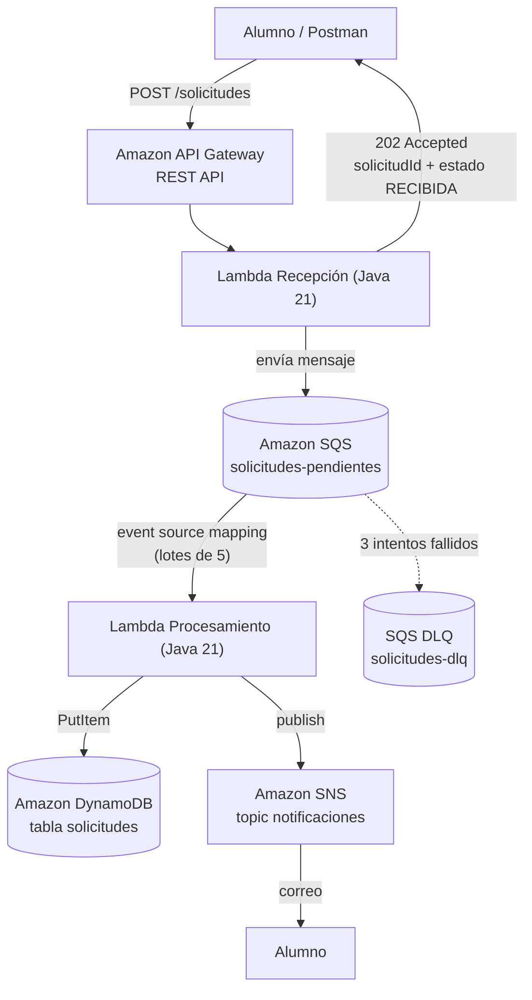

# Documento de Diseño — Sistema de Gestión de Solicitudes en AWS

**Curso:** JAVA — Diseño y Construcción de Soluciones Nativas en Nube
**Fecha:** Noviembre 2026
**Versión:** 1.0

---

## 1. Caso de negocio

Una institución educativa recibe solicitudes de sus alumnos. Hoy ese flujo es manual y lento.
Se quiere un sistema que reciba las solicitudes en línea y las procese automáticamente, sin
que el alumno espere en la llamada HTTP.

Tipos de solicitud soportados:

| Tipo | Descripción |
|---|---|
| `CERTIFICADO` | Solicitud de certificado (notas, alumno regular, etc.) |
| `REVISION_NOTAS` | Solicitud de revisión de notas de una asignatura |
| `SOPORTE_TECNICO` | Solicitud de soporte técnico |
| `INFO_ACADEMICA` | Solicitud de información académica |

---

## 2. Requisitos

### Requisitos funcionales

| # | Requisito |
|---|-----------|
| RF1 | El alumno registra una solicitud mediante `POST /solicitudes` con sus datos, tipo y descripción |
| RF2 | El sistema valida la solicitud en la recepción y rechaza con detalle los datos inválidos (HTTP 400) |
| RF3 | Las solicitudes válidas se procesan de forma **asíncrona** mediante una cola (el POST no espera el procesamiento) |
| RF4 | Cada solicitud procesada queda persistida con su estado y resultado |
| RF5 | Al finalizar el procesamiento, el alumno recibe una **notificación por correo** con el resultado |

### Requisitos no funcionales

| # | Requisito |
|---|-----------|
| RNF1 | Arquitectura **serverless**: sin servidores que administrar |
| RNF2 | **Desacoplamiento**: recepción y procesamiento comunican por cola (SQS) |
| RNF3 | **Resiliencia**: reintentos automáticos y cola de mensajes fallidos (DLQ) |
| RNF4 | **Infraestructura como código**: despliegue reproducible con AWS SAM |
| RNF5 | **Bajo costo**: servicios dentro del free tier de AWS para uso de laboratorio |

---

## 3. Arquitectura



### Componentes

| Componente | Servicio AWS | Responsabilidad |
|---|---|---|
| Punto de entrada | Amazon API Gateway (REST) | Expone `POST /solicitudes` |
| Recepción | AWS Lambda (Java 21) | Valida la solicitud, genera el `solicitudId`, encola en SQS y responde `202 Accepted` |
| Cola | Amazon SQS + DLQ | Desacopla recepción de procesamiento; amortigua picos de tráfico |
| Procesamiento | AWS Lambda (Java 21) | Consume mensajes, define el resultado según el tipo, persiste y notifica |
| Persistencia | Amazon DynamoDB | Almacena cada solicitud con su estado y resultado |
| Notificación | Amazon SNS | Envía el correo con el resultado al alumno |

### Flujo de ejecución

1. El alumno envía `POST /solicitudes` a API Gateway.
2. API Gateway invoca la Lambda de **Recepción**.
3. Recepción valida el cuerpo. Si es inválido responde `400` con el detalle y termina.
4. Recepción genera el `solicitudId`, arma la solicitud con estado `RECIBIDA` y la envía a **SQS**.
5. Recepción responde `202 Accepted` al alumno (no espera el procesamiento).
6. SQS activa la Lambda de **Procesamiento** (event source mapping, lotes de hasta 5 mensajes).
7. Procesamiento calcula el resultado según el tipo y guarda el ítem en **DynamoDB** con estado `PROCESADA`.
8. Procesamiento publica la notificación en **SNS**.
9. SNS envía el correo al alumno. Si algo falla, SQS reintenta (hasta 3 veces) y luego mueve el mensaje a la **DLQ**.

---

## 4. Decisiones de diseño

| # | Decisión | Alternativa descartada | Justificación |
|---|---|---|---|
| D1 | **DynamoDB** para persistir | RDS MySQL / Aurora | DynamoDB es nativo serverless: no requiere VPC, subnets ni security groups. Simplifica el despliegue y cabe en el free tier. RDS exigiría configurar red privada para las Lambdas. |
| D2 | Responder **202 Accepted** con el ID y estado `RECIBIDA` | 201 Created síncrono | Con procesamiento asíncrono no se debe hacer esperar al cliente. La cola SQS es la evidencia de lo "pendiente". |
| D3 | Cola SQS **estándar** | FIFO | No se requiere orden estricto entre solicitudes. FIFO agrega deduplicación, costo y límites innecesarios. |
| D4 | **Un solo escritor** en DynamoDB (la Lambda de procesamiento) | Recepción escribe `RECIBIDA` y procesador actualiza | Menos puntos de falla y menos contención. El estado `RECIBIDA` existe en la respuesta 202 y en el mensaje de la cola; el estado persistido es el final. |
| D5 | **DLQ** con `maxReceiveCount: 3` | Sin DLQ | Los mensajes que fallan repetidamente no bloquean la cola y quedan auditables en la DLQ. |
| D6 | **Idempotencia natural** por clave | Tabla de deduplicación | `PutItem` con PK = `solicitudId`: si SQS reintenta un lote, el ítem se sobrescribe (no se duplica). |
| D7 | Java 21 + AWS SDK v2 + Jackson, **sin framework** | Spring Cloud Function | Se ve el evento real de Lambda y el SDK tal cual; menos capas para un laboratorio didáctico. |
| D8 | Infraestructura como código con **AWS SAM** | Consola manual / Terraform | Un template + un comando despliega todo; reproducible para evaluación y fácil de borrar. |
| D9 | **Rol `LabRole`** pre-existente para todas las funciones | Roles IAM por función con políticas mínimas | El AWS Academy Learner Lab no permite crear roles ni policies IAM. El diseño de mínimo privilegio por función se mantiene como objetivo productivo (sección 9) y se aplicará en un entorno real. |

---

## 5. Contrato de la API

### `POST /solicitudes`

**Request** (Content-Type: application/json):

```json
{
  "alumno": {
    "nombre": "María Pérez Soto",
    "email": "maria.perez@duocuc.cl"
  },
  "tipo": "CERTIFICADO",
  "descripcion": "Necesito certificado de notas para postular a una beca"
}
```

**Response 202 Accepted** (la solicitud quedó encolada, aún no procesada):

```json
{
  "solicitudId": "b3f8c2a1-4d5e-4f6a-9b7c-1e2d3f4a5b6c",
  "estado": "RECIBIDA",
  "mensaje": "Su solicitud fue recibida y será procesada en breve. Recibirá un correo cuando esté lista."
}
```

**Response 400 Bad Request** (datos inválidos; nunca se encola):

```json
{
  "errores": [
    "El tipo debe ser uno de: CERTIFICADO, REVISION_NOTAS, SOPORTE_TECNICO, INFO_ACADEMICA.",
    "El email del alumno no es válido."
  ]
}
```

**Response 500** ante error interno (ej.: SQS no disponible).

### Reglas de validación

| Campo | Regla |
|---|---|
| `alumno.nombre` | Obligatorio, entre 3 y 100 caracteres |
| `alumno.email` | Obligatorio, formato de correo válido |
| `tipo` | Obligatorio, uno de los 4 tipos definidos |
| `descripcion` | Obligatoria, entre 10 y 500 caracteres |

---

## 6. Modelo de datos (DynamoDB)

**Tabla:** `solicitudes` — clave primaria simple, modo `PAY_PER_REQUEST` (on-demand).

| Atributo | Tipo | Descripción |
|---|---|---|
| `solicitudId` (PK) | String (S) | UUID generado en la recepción |
| `tipo` | String | `CERTIFICADO` / `REVISION_NOTAS` / `SOPORTE_TECNICO` / `INFO_ACADEMICA` |
| `descripcion` | String | Texto enviado por el alumno |
| `nombreAlumno` | String | Nombre del alumno |
| `emailAlumno` | String | Correo del alumno |
| `estado` | String | `PROCESADA` (estado persistido) |
| `fechaCreacion` | String | ISO-8601 (cuando el alumno la envió) |
| `fechaProcesamiento` | String | ISO-8601 (cuando la Lambda la procesó) |
| `resultado` | String | Respuesta de la institución según el tipo |

Ejemplo de ítem:

```json
{
  "solicitudId": "b3f8c2a1-4d5e-4f6a-9b7c-1e2d3f4a5b6c",
  "tipo": "CERTIFICADO",
  "descripcion": "Necesito certificado de notas para postular a una beca",
  "nombreAlumno": "María Pérez Soto",
  "emailAlumno": "maria.perez@duocuc.cl",
  "estado": "PROCESADA",
  "fechaCreacion": "2026-11-10T14:05:00Z",
  "fechaProcesamiento": "2026-11-10T14:05:12Z",
  "resultado": "Su certificado fue emitido y estará disponible para retiro en 3 días hábiles."
}
```

---

## 7. Estados de una solicitud

```
RECIBIDA ──(mensaje en SQS)──► PROCESADA ──► ítem en DynamoDB + correo SNS
    │
    └──(validación en recepción falla)──► HTTP 400, nunca entra al sistema
    └──(procesamiento falla 3 veces)──► mensaje a la DLQ para auditoría
```

- `RECIBIDA`: estado transitorio, visible en la respuesta 202 y en la cola SQS (mensajes visibles/invisibles en consola).
- `PROCESADA`: estado persistido, con `resultado` y `fechaProcesamiento`.

---

## 8. Confiabilidad

| Mecanismo | Implementación |
|---|---|
| Reintentos | SQS reintenta la entrega de un mensaje si la Lambda falla (lanza excepción) |
| Mensajes venenosos | Tras 3 recepciones fallidas el mensaje va a la DLQ (`solicitudes-dlq`) |
| Idempotencia | `PutItem` con PK = `solicitudId`: reintentos sobrescriben, no duplican |
| Visibility timeout | 60 s (> timeout de la Lambda de 25 s), evita doble procesamiento concurrente |
| Aislamiento de fallos | Una solicitud inválida se rechaza en recepción con 400 y nunca consume cola |

---

## 9. Seguridad

- **Diseño objetivo (producción): mínimo privilegio por función** — la Lambda de recepción solo podría `sqs:SendMessage` sobre su cola; la de procesamiento solo `dynamodb:PutItem` sobre su tabla y `sns:Publish` sobre su tópico.
- **Implementación actual (laboratorio):** el AWS Academy Learner Lab impide crear roles y policies IAM, por lo que todas las funciones usan el rol compartido `LabRole` del lab. Es una excepción documentada del entorno académico (decisión D9), no del diseño.
- No hay secretos en el código; el acceso a AWS se resuelve con el rol de ejecución de cada Lambda.
- La API es **pública sin autenticación** por simplicidad del laboratorio → mejora futura: API keys, Cognito o WAF.
- Validación de entrada en recepción: tipado, largos y formato de email, antes de tocar cualquier servicio.

---

## 10. Costos (aprox., uso de laboratorio)

| Servicio | Modelo | Estimado |
|---|---|---|
| Lambda | 1M requests y 400.000 GB-s gratis/mes | $0 |
| DynamoDB | 25 GB y 25 RCU/WCU gratis/mes (on-demand) | $0 |
| SQS | Primer millón de solicitudes gratis/mes | $0 |
| SNS | Primeros 1.000 emails gratis/mes | $0 |
| API Gateway (REST) | ~USD 3,50 por millón de llamadas | ≈ $0 en laboratorio |

**Entorno AWS Academy Learner Lab:** presupuesto limitado (~USD 50-100). Con este sistema el
consumo es mínimo, pero se debe ejecutar `sam delete` al finalizar cada sesión de trabajo
y desplegar de nuevo cuando se necesite (~3 minutos).

---

## 11. Despliegue y pruebas

El detalle paso a paso está en el **README del proyecto**: `salida/solicitudes-serverless/README.md`.
Puntos clave del entorno académico:

- Región obligatoria: `us-east-1` o `us-west-2` (únicas permitidas por el Learner Lab).
- Las Lambdas usan el rol `LabRole` del lab (no se crea IAM).
- Desde Cloud9 del lab, las credenciales llegan automáticamente vía `labInstanceProfile`;
  desde el equipo local, se exportan credenciales temporales desde "AWS Details" (expiran con la sesión).

Resumen de la demo:

1. Desplegar y confirmar la suscripción de correo SNS.
2. `POST /solicitudes` válido → se recibe `202` con `solicitudId` y estado `RECIBIDA`.
3. A los segundos llega el **correo** con el resultado.
4. En la consola AWS: el ítem aparece en DynamoDB con estado `PROCESADA`.
5. `POST` inválido → se recibe `400` con el detalle y **no** pasa nada más.

---

## 12. Mejoras futuras

| Mejora | Valor |
|---|---|
| `GET /solicitudes/{id}` | El alumno consulta el estado sin esperar el correo |
| `GET /solicitudes` con filtros (tipo, estado) + GSI en DynamoDB | Panel de solicitudes para la institución |
| Autenticación (Cognito / API keys) | Trazabilidad real por alumno y API protegida |
| Step Functions | Flujos con aprobación humana (ej.: revisión de notas la decide un docente) |
| X-Ray + logs estructurados | Observabilidad de extremo a extremo |
| Lambda Powertools / versiones y alias | Estándares productivos de despliegue |
